# Языки программирования
## Лабораторная работа 10

### Задание 1 **(2)**

*Рассмотрите следующие фрагменты программ. Запишите, что означают символы* **&** и  * *в каждом случае применения.*
```
int a = 10, b = 20;
int *p = &a , *q = &b;
p = q;
std::cout << *p <<' '<< *q << std::endl;
```
```
int a = 10, b = 20;
int *p = &a , *q = &b;
*p = *q;
std::cout << *p <<' '<< *q << std::endl;
```
*Чем различаются присваивания в третьей строке? Что можно вывести,
чтобы показать различия?*

*Примеры программ сохраните в папке с номером задания. Скриншоты работы прикрепите к отчету.*

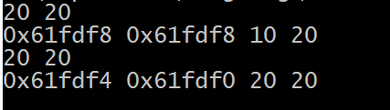

**Решение:**

Символ `*` при объявлении `int *p` и `int *q` означает создание указателей. В выражениях `*p` и `*q` он используется для разыменования, чтобы получить значение по адресу.
Символ `&` в `&a` и `&b` означает взятие адреса переменных.

В первой программе `p = q` меняет сам указатель: `p` теперь указывает на `b`. Сами переменные не меняются.
Во второй программе `*p = *q` меняет значение переменной: значение `b` записывается в `a`. Сами указатели остаются на месте.

Чтобы увидеть разницу, можно вывести адреса и значения переменных:
```cpp
std::cout << p << ' ' << q << ' ' << a << ' ' << b << std::endl;
```
В первом случае адреса совпадут, а значения останутся 10 и 20. Во втором случае адреса будут разными, а значения станут по 20.

```cpp
#include <iostream>

int main() {
    {
        int a = 10, b = 20;
        int *p = &a, *q = &b;
        p = q;
        std::cout << *p << ' ' << *q << std::endl;
        std::cout << p << ' ' << q << ' ' << a << ' ' << b << std::endl;
    }
    {
        int a = 10, b = 20;
        int *p = &a, *q = &b;
        *p = *q;
        std::cout << *p << ' ' << *q << std::endl;
        std::cout << p << ' ' << q << ' ' << a << ' ' << b << std::endl;
    }
    return 0;
}
```

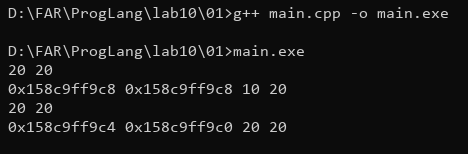

### Задание 2 **(1)**

*Рассмотрим следующую программу.* 
```
double x[10];
for (int i = 0; i <10; i++)
    std::cout << &x[i] << std::endl;
```
*Что она выводит? Измените
вывод так, чтобы адреса выводились в десятичной системе счисления.
Объясните почему числа составляют арифметическую прогрессию с
определенным шагом.*

*Записанную программу сохраните в папке с номером задания.*
*Скриншоты работы прикрепите к отчету.*

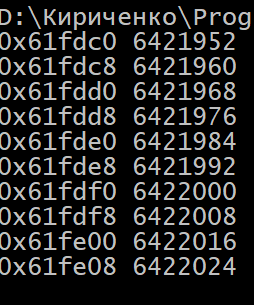

**Решение:**

Программа выводит адреса элементов массива в шестнадцатеричном виде.

Для вывода в десятичном виде адреса преобразуются к типу `uintptr_t`:

```cpp
#include <iostream>
#include <cstdint>

int main() {
    double x[10];
    for (int i = 0; i < 10; i++)
        std::cout << &x[i] << ' ' << reinterpret_cast<uintptr_t>(&x[i]) << std::endl;
    return 0;
}
```

Числа образуют арифметическую прогрессию, потому что элементы массива лежат в памяти подряд. Одно число `double` занимает 8 байт, поэтому каждый следующий адрес больше предыдущего ровно на 8.

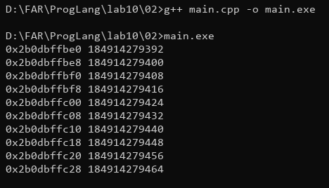

### Задание 3 **(2)**

*Токен* **«*»** *в языке C++ может использоваться в трех различных
случаях. Аналогично токен* **«&»** *также может использоваться в трех
случаях. Приведите пример одной программы в которой они были бы
использованы во всех случаях.*

*Записанную программу сохраните в папке с номером задания.*

**Решение:**

Случаи использования `*`:
- умножение: `a * b`
- объявление указателя: `int *p = &a`
- разыменование: `*p`

Случаи использования `&`:
- взятие адреса: `&a`
- объявление ссылки: `int &ref = a`
- побитовое И: `a & b`

```cpp
#include <iostream>

int main() {
    int a = 6;
    int b = 3;

    int mul = a * b;
    int *p = &a;
    int val = *p;

    int &ref = a;
    int bit_and = a & b;

    std::cout << "a * b = " << mul << std::endl;
    std::cout << "*p = " << val << std::endl;
    std::cout << "&a = " << p << std::endl;
    std::cout << "ref = " << ref << std::endl;
    std::cout << "a & b = " << bit_and << std::endl;

    return 0;
}
```

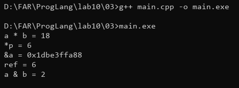

### Задание 4 **(2)**

*Выпишите значения всех переменных, в том числе указателей,
после выполнения каждой инструкции программы. Объясните, что
происходит в результате выполнения каждой инструкции.*
```
unsigned a = 8, b = 3 ,c = 17;
unsigned *p = &a;
unsigned *q = &b;
*p += *q + c;
c = *q;
p = &c;
c += a;
*p += 10;
*q = *p;
q = p ;
*q += 10;
```

**Решение:**

1. `unsigned a = 8, b = 3, c = 17;` – задаются начальные значения: `a = 8, b = 3, c = 17`.
2. `unsigned *p = &a;` – `p` указывает на `a`. Значения: `a = 8, b = 3, c = 17, *p = 8`.
3. `unsigned *q = &b;` – `q` указывает на `b`. Значения: `a = 8, b = 3, c = 17, *p = 8, *q = 3`.
4. `*p += *q + c;` – к `a` прибавляется 20. Значения: `a = 28, b = 3, c = 17, *p = 28, *q = 3`.
5. `c = *q;` – в `c` записывается значение `b`. Значения: `a = 28, b = 3, c = 3, *p = 28, *q = 3`.
6. `p = &c;` – `p` теперь указывает на `c`. Значения: `a = 28, b = 3, c = 3, *p = 3, *q = 3`.
7. `c += a;` – к `c` прибавляется `a`. Значения: `a = 28, b = 3, c = 31, *p = 31, *q = 3`.
8. `*p += 10;` – к `c` прибавляется 10. Значения: `a = 28, b = 3, c = 41, *p = 41, *q = 3`.
9. `*q = *p;` – в `b` записывается значение `c`. Значения: `a = 28, b = 41, c = 41, *p = 41, *q = 41`.
10. `q = p;` – `q` теперь тоже указывает на `c`. Значения: `a = 28, b = 41, c = 41, *p = 41, *q = 41`.
11. `*q += 10;` – к `c` прибавляется 10. Значения: `a = 28, b = 41, c = 51, *p = 51, *q = 51`.

В итоге значения переменных: `a = 28, b = 41, c = 51`. Указатели `p` и `q` оба ссылаются на `c`, поэтому `*p = 51` и `*q = 51`.

```cpp
#include <iostream>

int main() {
    unsigned a = 8, b = 3, c = 17;
    unsigned *p = &a;
    unsigned *q = &b;

    *p += *q + c;
    c = *q;
    p = &c;
    c += a;
    *p += 10;
    *q = *p;
    q = p;
    *q += 10;

    std::cout << "a = " << a << std::endl;
    std::cout << "b = " << b << std::endl;
    std::cout << "c = " << c << std::endl;
    std::cout << "*p = " << *p << std::endl;
    std::cout << "*q = " << *q << std::endl;

    return 0;
}
```

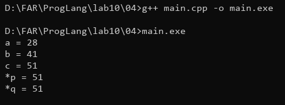

### Задание 5 **(1)**

*Что сравнивается в приведенной ниже программе? Как можно
изменить первую строчку программы, чтобы результат тоже
изменился?*
```
int x = 1, y = 2;
int *p = &y, *q = &x;
if (p < q)
    std::cout << "Yes";
else
    std::cout << "No";
```

**Решение:**

В условии сравниваются адреса переменных `y` и `x` в памяти, а не их значения 1 и 2.

Чтобы результат изменился на `No`, в первой строке нужно поменять переменные местами: `int y = 2, x = 1;`.

```cpp
#include <iostream>

int main() {
    int y = 2, x = 1;
    int *p = &y, *q = &x;
    if (p < q)
        std::cout << "Yes";
    else
        std::cout << "No";
    return 0;
}
```

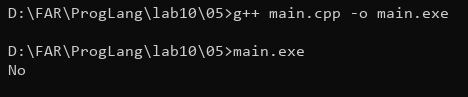

### Задание 6 **(2)**

*Объясните работу следующей программы. Как изменится
результат, если тип* **double** *изменить на некоторый другой, например*
**int** *или* **char**?
```
double x = 0;
double *d = &x;
std::cout << reinterpret_cast<size_t>(d + 4) - reinterpret_cast<size_t>(d - 4) << std::endl;
```

**Решение:**

Указатель `d` указывает на тип `double`, который занимает 8 байт. Смещение `d + 4` сдвигает адрес вперёд на 32 байта, а `d - 4` – назад на 32 байта. Разность этих адресов равна 64.

Если поменять тип:
- для `int` элемент занимает 4 байта, смещение равно 16 байт, а разность будет 32;
- для `char` элемент занимает 1 байт, смещение равно 4 байта, а разность будет 8.

```cpp
#include <iostream>

int main() {
    {
        double x = 0;
        double *d = &x;
        std::cout << "d =" << reinterpret_cast<size_t>(d) << std::endl;
        std::cout << "d+4 =" << reinterpret_cast<size_t>(d + 4) << std::endl;
        std::cout << "d-4 =" << reinterpret_cast<size_t>(d - 4) << std::endl;
        std::cout << "double: " << reinterpret_cast<size_t>(d + 4) - reinterpret_cast<size_t>(d - 4) << std::endl;
    }
    {
        int x = 0;
        int *d = &x;
        std::cout << "int:    " << reinterpret_cast<size_t>(d + 4) - reinterpret_cast<size_t>(d - 4) << std::endl;
    }
    {
        char x = 0;
        char *d = &x;
        std::cout << "char:   " << reinterpret_cast<size_t>(d + 4) - reinterpret_cast<size_t>(d - 4) << std::endl;
    }
    return 0;
}
```

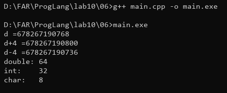

### Задание 7 **(2)**

*Объясните работу следующей программы. Как изменится
результат, если тип* **double** *изменить на некоторый другой, например*
**int** *или* **char**?
```
std::cout << reinterpret_cast <double*>(3000) - reinterpret_cast <double*>(2000) << std::endl;
```

**Решение:**

Разность двух указателей показывает, сколько элементов помещается между этими адресами. Расстояние между 3000 и 2000 равно 1000 байт. Поскольку `double` занимает 8 байт, получается `1000 / 8 = 125`.

Если изменить тип:
- для `int` при размере 4 байта результат будет `1000 / 4 = 250`;
- для `char` при размере 1 байт результат будет `1000 / 1 = 1000`.

```cpp
#include <iostream>

int main() {
    std::cout << reinterpret_cast<double*>(3000) - reinterpret_cast<double*>(2000) << std::endl;
    std::cout << reinterpret_cast<int*>(3000) - reinterpret_cast<int*>(2000) << std::endl;
    std::cout << reinterpret_cast<char*>(3000) - reinterpret_cast<char*>(2000) << std::endl;
    return 0;
}
```

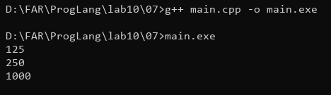

### Задание 8 **(2)**

*Что надо дописать в записанной ниже программе вместо многоточий, чтобы
она выводила все числа из массива* **a**? *Почему?*
```
int a[20];
for ( int i = 0; i < 20; i++)
    a[i] = i;
int *b=a + 8;
for (int i =...; i <...; i++)
    std::cout << b[i] <<' ';
```

**Решение:**

Вместо многоточий нужно дописать:
```cpp
for (int i = -8; i < 12; i++)
```
Указатель `b` указывает на `a[8]`. Запись `b[i]` обращается к элементу `a[8 + i]`. При `i = -8` получается первый элемент `a[0]`, а при `i = 11` – последний элемент `a[19]`.

```cpp
#include <iostream>

int main() {
    int a[20];
    for (int i = 0; i < 20; i++)
        a[i] = i;
    int *b = a + 8;
    for (int i = -8; i < 12; i++)
        std::cout << b[i] << ' ';
    return 0;
}
```

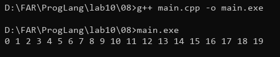

### Задание 9 **(2)**

*Что выводит следующая программа? Изменится ли результат если
изменить тип элементов массива?*

```
int a[10];
std::cout << &a[8] - &a[3] << std::endl;
```

**Решение:**

Программа выведет 5. При вычитании адресов элементов одного массива получается разность их индексов: 8 - 3 = 5.

Результат не изменится. Вычитание двух указателей одного типа возвращает количество элементов между ними, поэтому для любого типа данных ответ будет 5.

```cpp
#include <iostream>

int main() {
    {
        int a[10];
        std::cout << &a[8] - &a[3] << std::endl;
    }
    {
        double a[10];
        std::cout << &a[8] - &a[3] << std::endl;
    }
    {
        char a[10];
        std::cout << &a[8] - &a[3] << std::endl;
    }
    return 0;
}
```

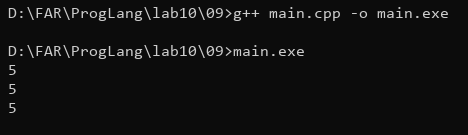

### Задание 10 **(1)**

*Есть ли разница между инициализацией* **p** и **q** *в следующей программе? Обоснуйте ответ.*
```
int x [10]={1, 2, 3, 4, 5, 6, 7, 8, 9, 10};
int *p = x + 5;
int *q = &x[5];
```

**Решение:**

Разницы нет, оба указателя указывают на один и тот же элемент массива. Выражения `x + 5` и `&x[5]` дают одинаковый адрес.

```cpp
#include <iostream>

int main() {
    int x[10] = {1, 2, 3, 4, 5, 6, 7, 8, 9, 10};

    int *p = x + 5;
    int *q = &x[5];

    std::cout << "p = " << p << std::endl;
    std::cout << "q = " << q << std::endl;
    std::cout << "p == q: " << (p == q) << std::endl;
    std::cout << "*p = " << *p << ", *q = " << *q << std::endl;

    return 0;
}
```

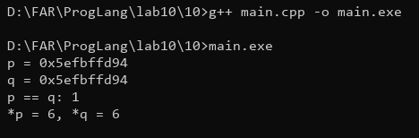

### Задание 11 **(3)**

*Указатели можно использовать для итерации по массивам.
Напишите программу, которая найдет сумму элементов массива,
используя указатели. В начале цикла указатель требуется установить
на начало массива, в конце каждой итерации смещать его к
следующему элементу массива через инкремент. Для выхода из цикла
надо проверять, что указатель дошел до конца массива.*
```
int x [10]={1, 2, 3, 4, 5, 6, 7, 8, 9, 10};
int s = 0;
for (int *p = ...; ...; ...)
    s += ...
std::cout << s;
```

*Записанную программу сохраните в папке с номером задания.*

**Решение:**

```cpp
#include <iostream>

int main() {
    int x[10] = {1, 2, 3, 4, 5, 6, 7, 8, 9, 10};
    int s = 0;
    for (int *p = x; p < x + 10; ++p)
        s += *p;
    std::cout << s;
    return 0;
}
```

Указатель `p` ставится на начало массива `x`, на каждом шаге сдвигается на следующий элемент через `++p` и прибавляет значение `*p` к сумме. Цикл завершается, когда `p` доходит до конца массива `x + 10`.

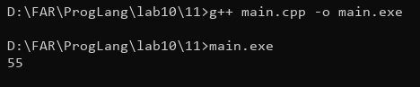
